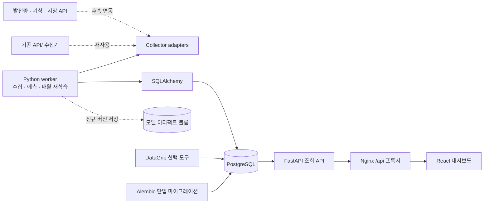
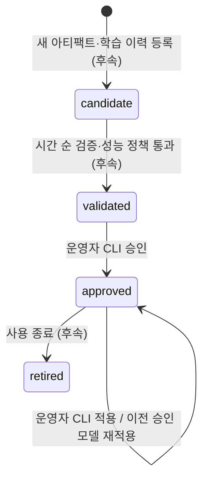

# 시스템 아키텍처

현재 목표는 2인이 같은 환경에서 실행·검토할 수 있는 개발용 기본 틀이다.
실제 외부 API, 모델 추론, 학습, 정산 계산은 계약과 확장 위치를 제공한다.

## 실행 서비스

| 서비스 | 역할 | 기동 조건 |
|---|---|---|
| db | PostgreSQL 17, 영속 볼륨 | `pg_isready` |
| migrate | Alembic `upgrade head`, 1회 종료 | DB healthy |
| api | FastAPI, SQLAlchemy 조회 | migrate 성공 |
| worker | APScheduler, 수집·예측·월별 학습 작업 | migrate 성공 |
| web | React 정적 빌드 + Nginx, 동일 출처 API 프록시 | API ready |
| tests | 선택 `test` profile, pytest/ruff | 독립 단위 테스트 |

DB/API/Web 포트는 로컬 루프백에 바인딩한다. Docker 네트워크에서는 `db:5432`,
`api:8000`으로 통신한다. 브라우저는 컨테이너 이름을 사용하지 않는다.
DB 준비와 마이그레이션 성공을 분리하는 구성은 [Compose 공식 문서](https://docs.docker.com/compose/how-tos/startup-order/),
스키마 변경은 [Alembic 공식 문서](https://alembic.sqlalchemy.org/en/latest/tutorial.html)를 따른다.

## 저장 구조

| 테이블 | 저장 내용 / 주요 제약 |
|---|---|
| observations | 발전량·관측·예보·시장 수집값, 출처/원천 키 unique, 대상/발표/입수 가능/수집 시각, demo 표시 |
| predictions | 모델 FK, 대상 ID, 대상/예측 기준 시각, kWh, 모델·대상·시각·기준 unique |
| settlements | 예측 FK, 규칙 버전, 원 단위 소수 금액, 시뮬레이션 표시, 계산 근거 JSON |
| model_versions | 버전 unique, 아티팩트 상대 경로·SHA-256·피처 스키마·지표·승인자, 활성 모델 최대 1개 |
| training_runs | 학습 기준 시각·데이터 스냅샷·지표·상태·메모 |
| job_runs | 작업 키 unique, 종류·상태·시작/종료·저장 건수·메시지 |

원시 관측값은 JSON에 단위를 포함한 명확한 키를 사용한다. 예:
`generation_kwh`, `temperature_c`, `smp_krw_kwh`. `scope_id`는 후속 연동에서
`region:11`, `plant:<stable-id>`, `market:land`처럼 집계 단위를 명시한다.
이번 데모는 `demo-region`만 사용한다. 실제 조회·집계 요구가 확정되면 측정별
정규화 테이블을 추가하는 마이그레이션을 검토한다.

시각은 UTC timezone-aware로 저장하고 UI에서 KST로 표시한다. 예보의 미래 대상 시각은
허용하지만 발표 시각과 입수 가능 시각이 예측 기준 시각을 넘으면 사용하지 않는다.
관측값을 미래에 알 수 있었던 예보처럼 사용하지 않는다. 실제 수집 시 과거 입수 가능
시각을 입증할 수 없으면 현재 입수 시각으로 기록한다. 데모는 실모델 입력에서 제외한다.

## 작업과 모델 생명주기

기본 모드는 `disabled`. 수집·예측·학습 미구현은 `job_runs.status=skipped`로 기록한다.
데모 모드는 명시적으로 선택할 때만 가상 수집값 3건을 저장한다. 가짜 예측·정산금은 만들지 않는다.

수집·예측 cron은 `.env`에서 변경한다. 기본값은 각각 매시 15분·30분,
재학습은 매월 1일 03:00 KST다. 시간대는 별도 OS 설정과 무관하다.
예측 성공 시에만 정산 작업을 이어 호출하는 자리를 둔다. 현 상태에서는 예측이 skipped이므로
정산은 자동 계산되지 않는다.

승인과 적용은 별도 CLI로만 수행한다. 승인 시 지표·피처 스키마·아티팩트 해시를 확인한다.
활성 버전 전환은 한 트랜잭션에서 처리하며 기존 파일을 바꾸지 않는다.
현재는 학습·후보 등록·검증 정책이 미구현이므로 실제 승인할 모델은 없다.
단일 활성 모델은 1차 설계다. 지역별 모델을 도입하면 활성화 범위 키를 확장한다.

스케줄러는 단일 worker를 사용한다. 실행 시 슬롯 키를 DB에 선점하여 같은 키를
중복 실행하지 않고 수집값도 출처/원천 키로 중복 방지한다. 수집 결과 쓰기와
실패 이력은 분리되어 작업 실패 시 부분 데이터가 롤백된다.
작업 도중 강제 종료되면 `running` 이력이 남을 수 있다. 자동 lease 회수·재시도·
누락 월 catch-up·분산 실행은 후속 작업이며 현재 worker 수를 늘리지 않는다.

## 개발 환경의 경계

DB 볼륨과 모델 볼륨을 분리한다. Git에는 코드·문서·마이그레이션·의존성만 기록한다.
API는 읽기 전용이고 사용자 인증이 없다. 인터넷 공개, 운영 배포, 백업 자동화,
장애 알림, API 쿼터 관리, 역할 기반 승인 권한은 후속 단계다.
표시할 경제 값은 규칙 확정 후에도 시뮬레이션과 실제 정산을 구별한다.
