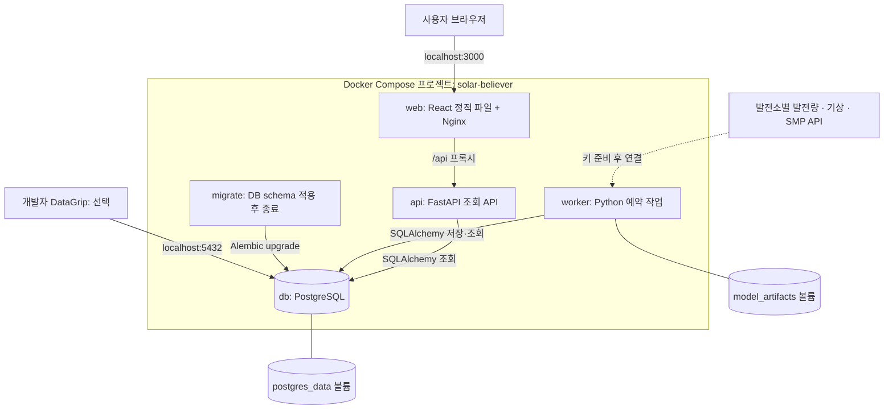
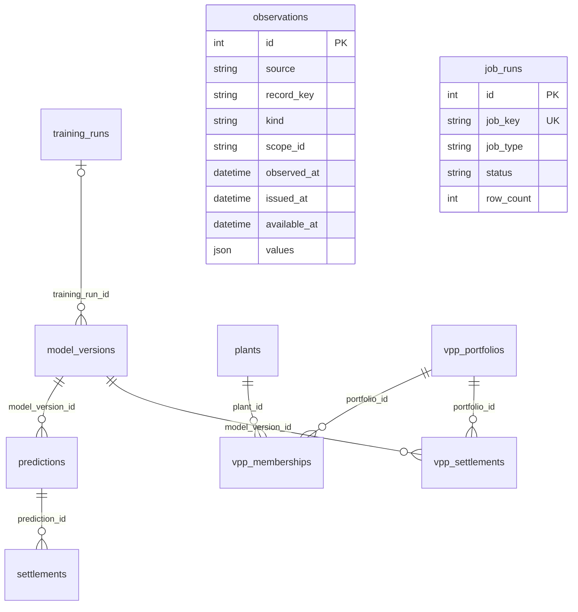
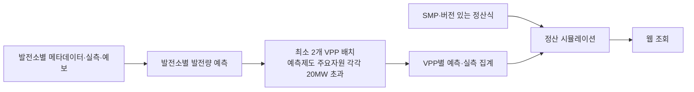

# 전체 구조: 현재 실행 환경과 발전소별 VPP 목표

기준일: 2026-11-19, `main@2a58fe2` 코드 기준. 이번 DB 실행 상태는 미검증이다.
실제 API 키 발급·활용 신청은 다른 팀원이 담당하며 live 호출 코드의 수정·운영 검증이 남아 있다.
목표는 **지속 수집 발전기 200개 이상 → 발전기별 예측 → 최소 2개 VPP → SMP·정산 시뮬레이션 → 웹 조회**다.
예측제도 기준 각 그룹 주요자원 용량은 20MW 초과다. [작업 인계](TEAM_HANDOFF.md)에 현황과 수정 위치를 정리했다.

## Docker에서 나눈 역할

| 서비스 | 현재 역할 | 계속 실행 여부 |
|---|---|---|
| db | 수집값·예측·정산·모델·학습·작업 이력 저장 | 실행 유지 |
| migrate | DB가 준비되면 Alembic schema 적용 | 성공 후 exit 0 |
| api | DB 조회, readiness, OpenAPI | 실행 유지 |
| worker | 수집·예보·예측·월별 학습 예약, 수동 작업 실행 | 실행 유지 |
| web | React 파일 제공, 브라우저 API 요청을 api로 전달 | 실행 유지 |
| tests | 선택 profile, pytest/Ruff | 요청한 검사 후 종료 |

Python api/worker/migrate는 동일 Dockerfile의 runtime 이미지를 공유하고 **실행 명령을 분리**한다.
각 기능마다 별도 Python 코드 복사본을 개발하지 않는다. tests는 개발 도구를 추가한 test stage를 사용한다.
DB healthy → migrate 성공 → api/worker 기동 → api ready → web 기동 순서다.
컨테이너끼리는 Compose 네트워크의 `db:5432`, `api:8000`을 사용하고,
브라우저·DataGrip은 로컬에 노출한 포트를 사용한다. DB/API/Web은 루프백에 바인딩한다.

볼륨은 PostgreSQL 물리 데이터와 모델 파일을 분리한다. 모델 경로·버전·SHA-256은 DB에,
모델 바이너리는 model_artifacts에 둔다. 현재 Python 서비스들은 이 볼륨을 공통 마운트한다.
DataGrip은 컨테이너로 넣지 않은 선택 도구다. Docker 없이 개발할 때는
[별도 실행 방법](DEVELOPMENT_WITHOUT_DOCKER.md)을 사용한다.

## 현재 DB 구분

현재 **PostgreSQL 서버 1개 / 서비스 DB `solar_believer` 1개 / `public` schema**다.
기능마다 DB를 따로 만들지 않고 **업무 테이블 10개**로 구분했다.
추가 `alembic_version`은 스키마 버전 관리용 내부 테이블이다.

| 테이블 | 저장하는 것 | 구분 방법 |
|---|---|---|
| observations | 발전량·기상 관측·예보·SMP 같은 수집값 | kind, scope_id, source, record_key, 시간, 단위 있는 JSON 값 |
| predictions | 예측 시각별 발전량, 모델 버전 | scope_id, target_at, cutoff_at, model_version_id |
| settlements | 정산 결과·계산 근거 | prediction_id, rule_version, amount_krw, is_simulation |
| model_versions | 모델 버전·파일 해시·지표·승인·활성 여부 | version unique, 승인 모델 최대 1개 활성 |
| training_runs | 학습 시도·데이터 기준·스냅샷·지표 | status, cutoff_at, data_snapshot |
| job_runs | 예약/수동 작업의 실행 결과 | job_key unique, job_type, status, row_count, 시작/종료 |
| plants | 발전소 메타데이터 | 안정 ID, 위경도, 용량, 가격 구역, 발전량 원천 |
| vpp_portfolios | VPP 그룹·구성 버전 | slug/version unique, 목표 용량 |
| vpp_memberships | 발전소의 그룹 소속·적용 기간 | plant/portfolio FK, 시작·종료 |
| vpp_settlements | 저장된 VPP 정산 결과 | 그룹·모델·시각·규칙 unique, 금액·손실·근거 |

observations와 job_runs는 다른 업무 테이블에 직접 FK가 없다.
현재 scope_id도 문자열이며 발전소 마스터에 연결된 FK는 아직 아니다.
원천별 테이블이나 발전소별 테이블을 각각 만드는 구조가 아니다.
같은 발전소의 시각별 데이터는 여러 행으로 누적한다.
예보는 대상 시각과 발표 시각을 나눠 저장해 같은 대상의 여러 발표분을 보존한다.

## 발전소별 VPP의 현재와 후속

현재 발전소·VPP·구성원·VPP 정산 테이블은 `0002` migration으로 추가했다.
지도와 기간/모델 필터는 등록된 구성원의 예측·실측을 조회 시 집계하며 별도
vpp_predictions 테이블에 저장하지 않는다. 정산금은 vpp_settlements에 이미 저장된 결과만 읽는다.
남동발전 원천 CSV와 임시 자원 등록/그룹 구성 코드가 추가됐다. CSV 자동 DB 적재·자원 적격성 검증·
VPP 자동 배치·실제 모델 추론·정산 엔진은 아직 구현/검증하지 않았다.

그룹·기간·모델 선택이 지도/그래프/요약에 함께 적용되며, 금전적 손실은 발전량 오차와
구별한다. 자세한 조건은 [대시보드 계약](DASHBOARD.md)을 따른다.

예측 모델은 발전소별 발전량을 출력하고 VPP 구성 알고리즘이 그 출력을 받아 배치한다.
VPP 용량은 시간 구간의 발전량(kWh)이 아닌 **설비용량(kW/MW)** 기준이다.
예측제도에서는 주요자원 20MW 초과가 조건이다. 남은 자원·변경 이력·구성 적격성을 별도로 검증하고
한 발전기를 임의 분할해 독립 실측 자원 수를 늘리지 않는다. [정산 명세](SETTLEMENT_RULES.md)를 따른다.
시도별 KPX 집계 데이터를 개별 발전소 실측으로 나누어 사용하지 않는다.
웹은 백엔드의 조회 집계와 저장된 정산 결과를 표시하며 규칙·모델·구성 버전을 구별한다.
