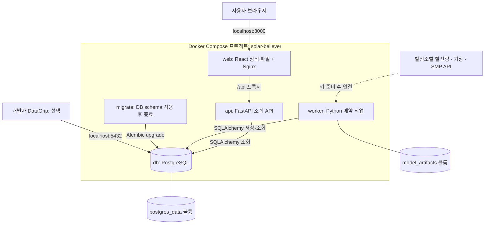
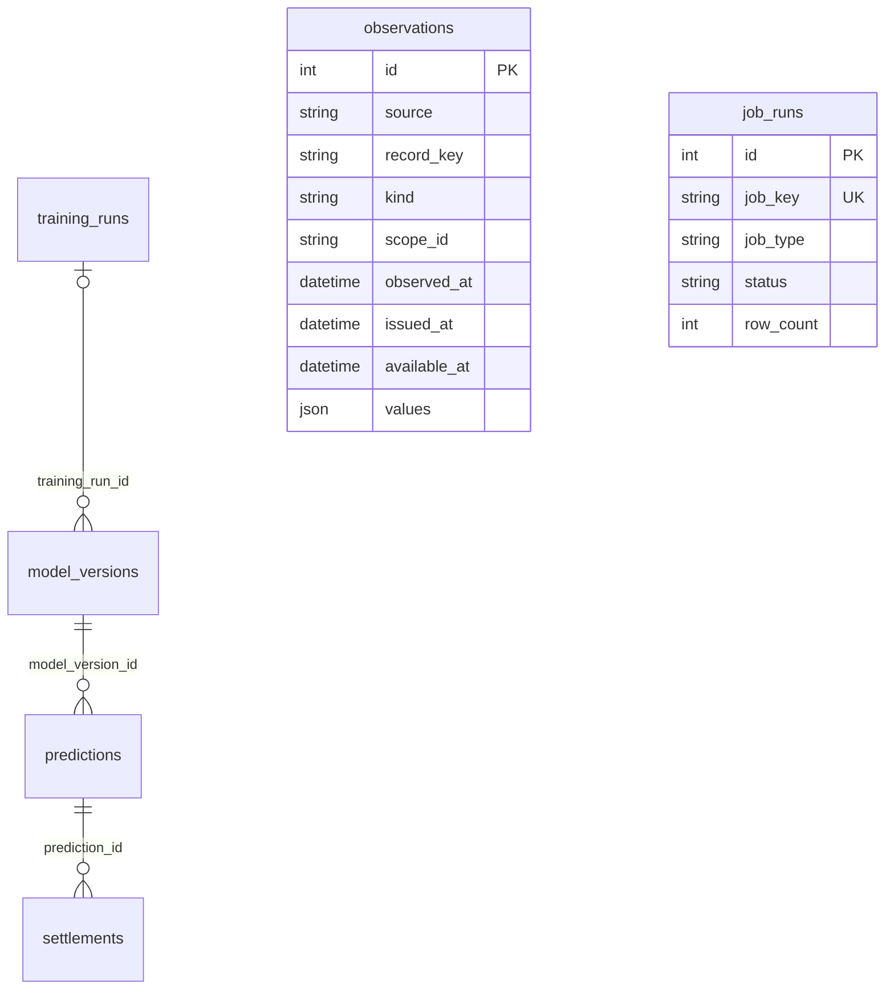
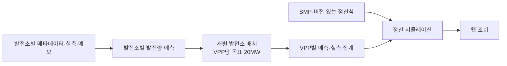

# 전체 구조: 현재 실행 환경과 발전소별 VPP 목표

기준일: 2026-11-17. 현재 실행 코드와 DB를 기준으로 작성했다.
실제 API 키 발급·활용 신청은 다른 팀원이 담당하며 API 연결은 아직 미구현이다.
목표는 **발전소별 발전량 예측 → 여러 20MW 목표 VPP 구성 → SMP·정산식 적용 → 웹 조회**다.

## Docker에서 나눈 역할

| 서비스 | 현재 역할 | 계속 실행 여부 |
|---|---|---|
| db | 수집값·예측·정산·모델·학습·작업 이력 저장 | 실행 유지 |
| migrate | DB가 준비되면 Alembic schema 적용 | 성공 후 exit 0 |
| api | DB 조회, readiness, OpenAPI | 실행 유지 |
| worker | 수집·예보·예측·월별 학습 예약, 수동 작업 실행 | 실행 유지 |
| web | React 파일 제공, 브라우저 API 요청을 api로 전달 | 실행 유지 |
| tests | 선택 profile, pytest/Ruff | 요청한 검사 후 종료 |

Python api/worker/migrate는 동일 Dockerfile의 runtime 이미지를 공유하고 **실행 명령을 분리**한다.
각 기능마다 별도 Python 코드 복사본을 개발하지 않는다. tests는 개발 도구를 추가한 test stage를 사용한다.
DB healthy → migrate 성공 → api/worker 기동 → api ready → web 기동 순서다.
컨테이너끼리는 Compose 네트워크의 `db:5432`, `api:8000`을 사용하고,
브라우저·DataGrip은 로컬에 노출한 포트를 사용한다. DB/API/Web은 루프백에 바인딩한다.

볼륨은 PostgreSQL 물리 데이터와 모델 파일을 분리한다. 모델 경로·버전·SHA-256은 DB에,
모델 바이너리는 model_artifacts에 둔다. 현재 Python 서비스들은 이 볼륨을 공통 마운트한다.
DataGrip은 컨테이너로 넣지 않은 선택 도구다. Docker 없이 개발할 때는
[별도 실행 방법](DEVELOPMENT_WITHOUT_DOCKER.md)을 사용한다.

## 현재 DB 구분

현재 **PostgreSQL 서버 1개 / 서비스 DB `solar_believer` 1개 / `public` schema**다.
기능마다 DB를 따로 만들지 않고 **업무 테이블 6개**로 구분했다.
추가 `alembic_version`은 스키마 버전 관리용 내부 테이블이다.

| 테이블 | 저장하는 것 | 구분 방법 |
|---|---|---|
| observations | 발전량·기상 관측·예보·SMP 같은 수집값 | kind, scope_id, source, record_key, 시간, 단위 있는 JSON 값 |
| predictions | 예측 시각별 발전량, 모델 버전 | scope_id, target_at, cutoff_at, model_version_id |
| settlements | 정산 결과·계산 근거 | prediction_id, rule_version, amount_krw, is_simulation |
| model_versions | 모델 버전·파일 해시·지표·승인·활성 여부 | version unique, 승인 모델 최대 1개 활성 |
| training_runs | 학습 시도·데이터 기준·스냅샷·지표 | status, cutoff_at, data_snapshot |
| job_runs | 예약/수동 작업의 실행 결과 | job_key unique, job_type, status, row_count, 시작/종료 |

observations와 job_runs는 다른 업무 테이블에 직접 FK가 없다.
현재 scope_id도 문자열이며 발전소 마스터에 연결된 FK는 아직 아니다.
원천별 테이블이나 발전소별 테이블을 각각 만드는 구조가 아니다.
같은 발전소의 시각별 데이터는 여러 행으로 누적한다.
예보는 대상 시각과 발표 시각을 나눠 저장해 같은 대상의 여러 발표분을 보존한다.

## 발전소별 20MW VPP를 위해 추가할 구조

이 흐름의 VPP 구성·집계·정산 실행은 **후속 구현**이다. 현재 테이블이 이미 발전소별
VPP 구성원을 관리한다고 해석하면 안 된다. 다음 schema 확장안은 아래와 같다.

| 추가 예정 | 역할 |
|---|---|
| plants | 안정적인 발전소 ID, 동일 기준 설비용량(kW), 위치, 예보 격자, 가격 구역 |
| vpp_portfolios | VPP ID, 목표 용량 20,000kW, 구성 정책·버전 |
| vpp_memberships | 어떤 발전소가 어느 VPP에 속하는지, 적용 기간, 배분/중복 배치 제약 |
| vpp_predictions | 구성 버전에 따른 VPP별 예측·실측 집계 |
| settlements 연결 확장 | 발전소 예측과 VPP 집계 중 실제 정산 대상을 명확한 FK로 연결 |

예측 모델은 발전소별 발전량을 출력하고 VPP 구성 알고리즘이 그 출력을 받아 배치한다.
VPP 목표 용량은 순간 발전량(kWh)이 아닌 **설비용량(kW/MW)** 기준이다.
20MW 초과 허용 여부, 남은 발전소 처리, 한 발전소의 분할 허용 여부는 별도 정책으로 정한다.
시도별 KPX 집계 데이터를 개별 발전소 실측으로 나누어 사용하지 않는다.
웹은 백엔드에 저장된 계산 결과를 조회하며, 정산 규칙과 VPP 구성 버전을 함께 표시하도록 확장한다.
